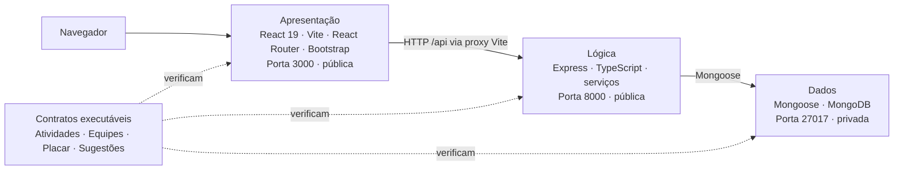

# Arquitetura do OctoFit Tracker

O OctoFit Tracker é uma aplicação de três camadas para um programa de atividades físicas escolar. O código inicial inclui contratos de API e pontos de implementação intencionalmente incompletos para que você use o modo agent do GitHub Copilot em um ciclo guiado por testes.

## Limites entre as camadas

- **Camada de apresentação**: React 19, Vite, React Router, Bootstrap e um cliente compartilhado da API em `octofit-tracker/frontend/src`.
- **Camada de lógica**: rotas e serviços Express com TypeScript em `octofit-tracker/backend/src` expõem o comportamento `/api/*` na porta `8000`.
- **Camada de dados**: modelos Mongoose e dados de demonstração em `octofit-tracker/backend/src/models` e `src/scripts/seed.ts` são persistidos no MongoDB na porta `27017`.

## Portas e regras de ambiente

- MongoDB: `27017` (privada)
- API Express: `8000` (pública)
- Interface Vite: `3000` (pública)
- O navegador acessa caminhos relativos `/api`. O Vite os encaminha para `http://localhost:8000`; `VITE_API_BASE_URL` pode substituir a URL-base.
- Não encaminhe nem torne públicas outras portas.

## Contrato da API

| Capacidade | Método e caminho | Comportamento esperado |
| --- | --- | --- |
| Registro de atividades | `GET /api/activities`, `POST /api/activities` | Lista e cria atividades válidas. POST recebe `userId`, `teamId`, `type` e `minutes`; `userId` e `teamId` devem ser IDs bem-formados de uma pessoa e uma equipe existentes, caso contrário a API retorna um 4xx intencional (nunca um 500 causado por erro de conversão). Uma atividade criada armazena `user`, `team`, `type` e `minutes` enviados, além de `points` e `occurredAt` calculados. |
| Equipes | `GET /api/teams`, `POST /api/teams` | Lista e cria equipes com integrantes. As equipes criadas e listadas mantêm os valores enviados em `name` e `mascot`. Rejeita uma equipe sem nome com `400`. |
| Placar | `GET /api/leaderboard` | Retorna as equipes ordenadas pela soma dos pontos de suas atividades, da maior para a menor. Cada item contém `teamName`, `totalPoints` e uma `rank` iniciada em 1. |
| Sugestões de treino | `GET /api/workouts/suggestions/:userEmail` | Recomenda treinos com base nos padrões de atividade recentes da pessoa correspondente ao e-mail seed. O foco da primeira sugestão (`focus`) corresponde à meta ou à atividade recente dessa pessoa, e o campo `reason` explica o motivo. Um e-mail sem pessoa correspondente retorna um 4xx intencional (por exemplo, `404`). |

## Decisões de implementação

Plano registrado antes da implementação. O código atual ainda contém os esqueletos da etapa inicial (rotas que respondem `501`, placar vazio e cartões com "Implementação pendente").

### Camadas

| Camada | Decisão | Arquivos envolvidos |
| --- | --- | --- |
| Apresentação | Todas as telas consomem `getJson` de `src/api/client.ts`, que monta URLs relativas `/api`. Cada rota exibe carregamento (`role="status"`), estado vazio, sucesso e erro (`role="alert"`), com textos em português do Brasil. Os componentes não chamam `fetch` diretamente. | `octofit-tracker/frontend/src/api/client.ts`, `src/components/*.tsx` |
| Lógica | As rotas continuam em `/api/*`. Os serviços concentram a validação de entrada e as regras de negócio. Erros com `status` seguem para o middleware de `app.ts`, que responde com o código intencional. | `octofit-tracker/backend/src/routes/api.ts`, `src/services/octofitService.ts`, `src/app.ts` |
| Dados | Os esquemas Mongoose declaram os campos obrigatórios que os testes de contrato exigem. A demonstração é inserida por upsert e nunca limpa coleções. A troca de equipe de uma pessoa de demonstração remove a associação anterior. | `octofit-tracker/backend/src/models/*.ts`, `src/scripts/seed.ts` |

### Capacidades

- **Registro de atividades**: `POST` valida que `userId` e `teamId` são IDs bem-formados antes de consultar o banco. Se a pessoa ou a equipe não existir, a API responde `4xx` (não `500`). `points` é calculado a partir dos `minutes` enviados, e `occurredAt` recebe a data do registro. O `GET` lista as atividades sem alterá-las.
- **Gerenciamento de equipes**: `POST` rejeita um corpo sem `name` com `400`. `name` e `mascot` são gravados como recebidos. Os integrantes são listados na própria equipe, conforme o modelo `Team`.
- **Placar**: agregação no MongoDB que soma `points` por equipe, ordena da maior para a menor pontuação e atribui `rank` a partir de 1. Equipes sem atividades: **a definir** (o contrato não especifica se aparecem com `0`).
- **Sugestões de treino**: a pessoa é encontrada pelo e-mail. Um e-mail sem correspondência retorna `404`. O `focus` vem da meta da pessoa (`fitnessGoal`), e o `reason` explica a escolha com base nessa meta ou na atividade recente.

## Plano de testes

Comandos executados na linha de base (sem implementação) e o significado de cada falha. Todos os comandos foram executados a partir da raiz do repositório.

| Comando | Resultado na linha de base | Significado das falhas |
| --- | --- | --- |
| `npm run test:data --prefix octofit-tracker/backend` | 4 falhas, 1 aprovado | Os esquemas não declaram campos obrigatórios: `User` (identidade e meta), `Team` (`name`, `mascot`), `Activity` (`type`, `user`, `team`, `minutes`, `points`, `occurredAt`) e `Workout` (`focus`, `minutes`, `difficulty`). Corrija os esquemas, não o teste. |
| `npm run test:api --prefix octofit-tracker/backend` | 4 falhas, 0 aprovados | `POST /api/activities` e `POST /api/teams` respondem `501` onde o contrato exige `400` para entradas inválidas. `GET /api/leaderboard` retorna `[]` (serviço ainda não implementado). `GET /api/workouts/suggestions/:userEmail` não retorna `reason`. |
| `npm test --prefix octofit-tracker/frontend` | 15 falhas, 0 aprovados | Os cartões exibem "Implementação pendente" e não fazem requisições. As falhas de carregamento, vazio, erro e dados exibidos indicam que a camada de apresentação ainda não consome a API. |
| `npm run build --prefix octofit-tracker/backend` | Aprovado (`tsc --noEmit`) | O código compila, mas a compilação não prova o comportamento da API. |
| `npm run build --prefix octofit-tracker/frontend` | Aprovado (`tsc --noEmit` e `vite build`) | O aplicativo compila e gera o pacote de produção. Não prova que os estados da interface funcionam. |

### Ordem de execução

1. Torne verdes os testes de dados, pois os serviços dependem dos esquemas validados.
2. Implemente cada capacidade da API até que `npm run test:api` passe para ela.
3. Implemente as telas com o mesmo ciclo, até que `npm test --prefix octofit-tracker/frontend` passe.
4. Repita as compilações e verifique manualmente as portas 8000 e 3000.

### Verificações manuais

- `curl http://localhost:8000/api/activities` deve retornar `200` com a lista de atividades.
- `curl -i -X POST http://localhost:8000/api/activities -H "Content-Type: application/json" -d "{}"` deve retornar `4xx`, nunca `500` ou `201`.

